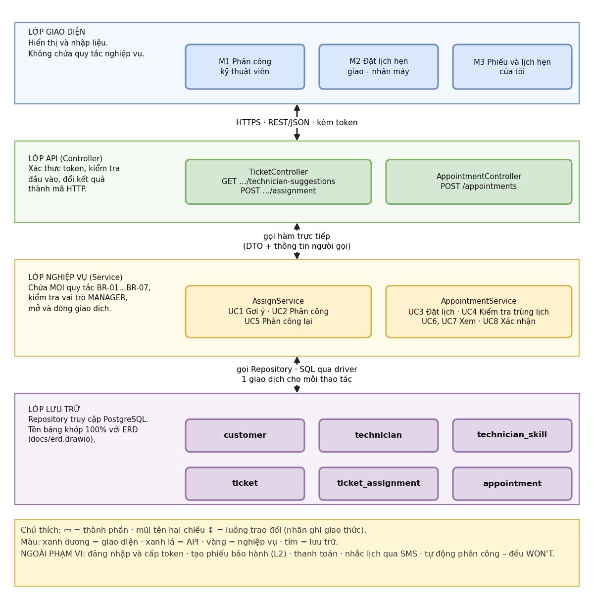

# Thiết kế kiến trúc – L4. Phân công kỹ thuật viên và lịch hẹn

Sơ đồ gốc: `docs/architecture.drawio` · Ảnh xuất: `docs/export/architecture.png`

## 1. Trách nhiệm từng lớp và cách trao đổi

| Lớp | Trách nhiệm | Thành phần | Trao đổi với lớp dưới |
|-----|-------------|-----------|-----------------------|
| Giao diện | Hiển thị và nhập liệu; không chứa quy tắc nghiệp vụ | M1, M2, M3 | HTTPS · REST/JSON · kèm token |
| API (Controller) | Xác thực token, kiểm tra đầu vào, đổi kết quả thành mã HTTP | `TicketController`, `AppointmentController` | Gọi hàm trực tiếp, truyền DTO và thông tin người gọi |
| Nghiệp vụ (Service) | Mọi quy tắc BR-01 đến BR-07, kiểm tra vai trò, mở và đóng giao dịch | `AssignService`, `AppointmentService` | Gọi Repository, một giao dịch cho mỗi thao tác |
| Lưu trữ | Truy cập PostgreSQL qua driver | `customer`, `technician`, `technician_skill`, `ticket`, `ticket_assignment`, `appointment` | SQL |

**Ngoài phạm vi:** hệ thống tài khoản thật (dùng 4 tài khoản demo cấp token 60 phút), tạo phiếu bảo hành (L2), thanh toán, nhắc lịch qua SMS và tự động phân công (WON'T).

**Hiện thực (Sprint 2):** lớp Giao diện = `src/frontend/` (`pages/`, `components/DataState.js`, `api/`); lớp API = `src/routes/`; lớp Nghiệp vụ = `src/services/`; lớp Lưu trữ = `src/repositories/`. Giao diện chỉ gọi API qua `src/frontend/api/`, không gọi thẳng CSDL.

## 2. Ba câu lập luận

Khuôn: *Vì \<mã NFR\> yêu cầu \<ngưỡng\>, tôi chọn \<quyết định\>, đánh đổi là \<chi phí\>.*

1. Vì **NFR2** yêu cầu 0 phiếu có hơn một kỹ thuật viên phụ trách và 0 cặp lịch hẹn chồng nhau của cùng một kỹ thuật viên, kể cả khi hai quản lý thao tác đồng thời, tôi chọn kiểm tra quy tắc ở lớp nghiệp vụ trong một giao dịch và thêm ràng buộc `EXCLUDE` (`ex_appt_no_overlap`) ngay trong CSDL thay vì chỉ kiểm tra bằng code; đánh đổi là phải bật extension `btree_gist` và phải đổi lỗi vi phạm ràng buộc thành mã 409 ở lớp API.

2. Vì **NFR1** yêu cầu API gợi ý kỹ thuật viên trả kết quả trong 2 giây ở phân vị 95 với tối đa 100 kỹ thuật viên và 1.000 phiếu mở, tôi chọn index ghép `(technician_id, status)` trên `ticket` để đếm khối lượng công việc thay vì lưu sẵn một cột đếm trong `technician`; đánh đổi là mỗi lần gợi ý phải chạy một truy vấn đếm, và mỗi lần cập nhật phiếu ghi chậm hơn một chút vì phải cập nhật index.

3. Vì **NFR3** yêu cầu chỉ vai trò `MANAGER` được phân công và đặt lịch (vai trò khác nhận mã 403), tôi chọn kiểm tra vai trò ở `AssignService` và `AppointmentService` thay vì chỉ ẩn nút trên giao diện; đánh đổi là mọi service phải nhận thêm thông tin người gọi trong mỗi lời gọi hàm.

## 3. Đối chiếu nhanh

| Câu | Mã NFR | Ngưỡng | Quyết định | Đánh đổi |
|-----|--------|--------|-----------|----------|
| 1 | NFR2 | 0 phiếu hai người phụ trách, 0 lịch chồng nhau | Giao dịch + `EXCLUDE` | `btree_gist`, xử lý lỗi 409 |
| 2 | NFR1 | ≤ 2 giây ở p95, 100 kỹ thuật viên, 1.000 phiếu mở | Index ghép, không lưu cột đếm | Truy vấn đếm, ghi chậm hơn một chút |
| 3 | NFR3 | Chỉ `MANAGER`, nếu không 403 | Kiểm tra vai trò ở lớp nghiệp vụ | Mọi service nhận thông tin người gọi |
