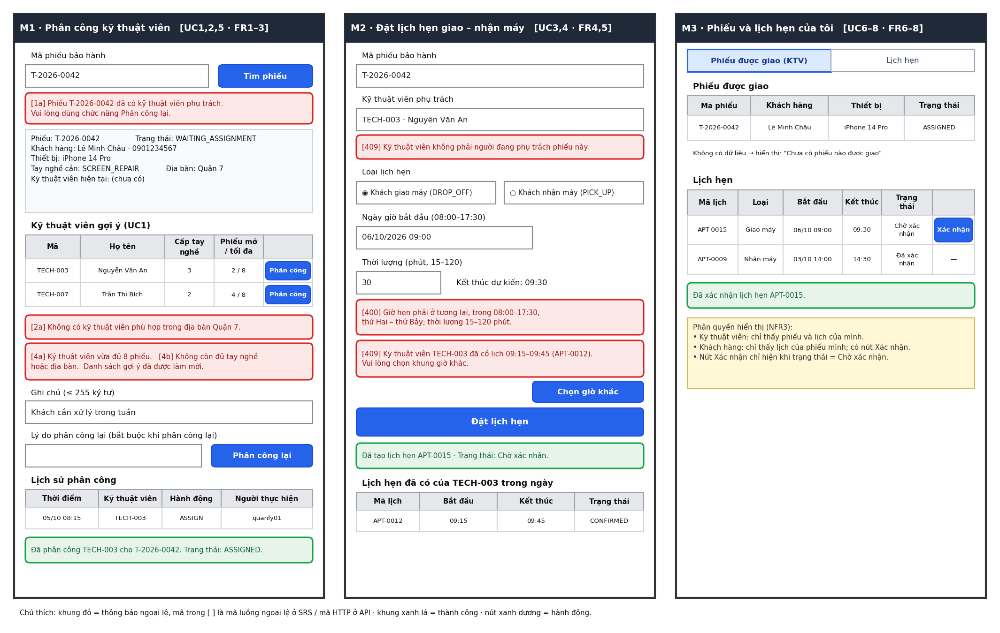

# Wireframe 3 màn hình – L4

Sơ đồ gốc: `docs/wireframe.drawio` · Ảnh xuất: `docs/export/wireframe.png`

## 1. Trường hiển thị ↔ mô hình dữ liệu (phép 4)

| Màn hình | Trường trên wireframe | Bảng.cột |
|----------|----------------------|----------|
| M1 | Mã phiếu bảo hành | `ticket.ticket_code` |
| M1 | Khách hàng, số điện thoại | `customer.full_name`, `customer.phone` |
| M1 | Thiết bị, Tay nghề cần, Địa bàn, Trạng thái | `ticket.device_model`, `ticket.required_skill`, `ticket.service_area`, `ticket.status` |
| M1 | Kỹ thuật viên hiện tại | `technician.full_name` qua `ticket.technician_id` |
| M1 | Mã, Họ tên (bảng gợi ý) | `technician.technician_code`, `technician.full_name` |
| M1 | Cấp tay nghề | `technician_skill.skill_level` |
| M1 | Phiếu mở / tối đa | Đếm `ticket` theo `technician_id` và `status`; `technician.max_open_tickets` |
| M1 | Ghi chú, Lý do phân công lại | `ticket_assignment.note`, `ticket_assignment.reason` |
| M1 | Lịch sử: Thời điểm, Kỹ thuật viên, Hành động, Người thực hiện | `ticket_assignment.assigned_at`, `technician_id`, `action`, `assigned_by` |
| M2 | Mã phiếu bảo hành, Kỹ thuật viên phụ trách | `ticket.ticket_code`, `technician.technician_code`, `technician.full_name` |
| M2 | Loại lịch hẹn | `appointment.appt_type` |
| M2 | Ngày giờ bắt đầu, Kết thúc dự kiến | `appointment.start_at`, `appointment.end_at` |
| M2 | Thời lượng (phút) | Ô nhập; hệ thống tính `end_at = start_at + thời lượng`, không lưu cột riêng |
| M2 | Lịch hẹn đã có: Mã lịch, Bắt đầu, Kết thúc, Trạng thái | `appointment.appointment_code`, `start_at`, `end_at`, `status` |
| M3 | Phiếu được giao: Mã phiếu, Khách hàng, Thiết bị, Trạng thái | `ticket.ticket_code`, `customer.full_name`, `ticket.device_model`, `ticket.status` |
| M3 | Lịch hẹn: Mã lịch, Loại, Bắt đầu, Kết thúc, Trạng thái | `appointment.appointment_code`, `appt_type`, `start_at`, `end_at`, `status` |
| M3 | Nút Xác nhận | Cập nhật `appointment.status` |

## 2. Bảng ↔ màn hình (chiều ngược lại của phép 4)

| Bảng | Xuất hiện ở |
|------|-------------|
| `customer` | M1, M3 |
| `technician` | M1, M2 |
| `technician_skill` | M1 |
| `ticket` | M1, M3 |
| `ticket_assignment` | M1 (khung Lịch sử phân công) |
| `appointment` | M2, M3 |

## 3. Luồng ngoại lệ ↔ chỗ hiển thị thông báo (phép 6)

| Luồng ngoại lệ | Nội dung thông báo | Vị trí |
|----------------|-------------------|--------|
| UC2 – 1a | Phiếu đã có kỹ thuật viên phụ trách, dùng Phân công lại | M1, dưới ô Mã phiếu |
| UC2 – 2a | Không có kỹ thuật viên phù hợp | M1, dưới bảng gợi ý |
| UC2 – 4a | Kỹ thuật viên vừa đủ 8 phiếu, danh sách đã làm mới | M1, dưới bảng gợi ý |
| UC2 – 4b | Kỹ thuật viên không còn đủ tay nghề hoặc địa bàn | M1, cùng khung với 4a |
| API 400 | Giờ hẹn ngoài khoảng cho phép hoặc thời lượng sai | M2, dưới ô Thời lượng |
| API 409 `APPOINTMENT_CONFLICT` | Kỹ thuật viên đã có lịch trong khung giờ, kèm nút Chọn giờ khác | M2, trên nút Đặt lịch hẹn |
| API 409 `TECHNICIAN_NOT_ASSIGNED` | Kỹ thuật viên không phụ trách phiếu | M2, dưới ô Kỹ thuật viên phụ trách |

## 4. Hiện thực wireframe (Sprint 2)

Giao diện web đã đối chiếu từng khối với ba wireframe ở trên (lần chỉnh ngày 23/10/2026, TD-14).

| Wireframe | Khối trong wireframe | Hiện thực | File |
|-----------|----------------------|-----------|------|
| M1 Phân công kỹ thuật viên | Mã phiếu + nút Tìm phiếu | Ô tìm phiếu, kiểm tra định dạng `T-YYYY-NNNN`, chuyển tới chi tiết | `components/TicketSearch.js` |
| | Hộp thông tin phiếu | Khách, thiết bị, tay nghề, địa bàn, kỹ thuật viên hiện tại | `TicketDetailPage.js` |
| | [1a] đã có kỹ thuật viên | Thông báo đỏ "Vui lòng dùng chức năng Phân công lại" | `TicketDetailPage.js` |
| | Bảng gợi ý + nút Phân công; [2a] rỗng | Bảng 4 cột, thông báo rỗng theo địa bàn | `TicketDetailPage.js` |
| | [4a][4b] đủ 8 phiếu / hết điều kiện | Thông báo 409 và tự làm mới danh sách gợi ý | `TicketDetailPage.js` |
| | Ghi chú ≤ 255 ký tự | Ô ghi chú, gửi kèm khi phân công | `TicketDetailPage.js` |
| | Lý do + nút Phân công lại | Hoạt động (FR3, TD-15): bảng kỹ thuật viên thay thế, lý do bắt buộc, lịch hẹn chuyển theo | `TicketDetailPage.js` |
| | Lịch sử phân công | Bảng thời điểm, kỹ thuật viên, hành động, người thực hiện, ghi chú | `TicketDetailPage.js` |
| M2 Đặt lịch hẹn | Mã phiếu; kỹ thuật viên phụ trách | Tìm phiếu rồi tự điền kỹ thuật viên (chỉ đọc) | `AppointmentPage.js` |
| | Loại lịch hẹn | Hai nút chọn DROP_OFF, PICK_UP | `AppointmentPage.js` |
| | Ngày giờ, thời lượng, kết thúc dự kiến | Ô ngày giờ, ô phút 15–120, giờ kết thúc tính tức thì | `AppointmentPage.js`, `ui.js` |
| | [400] ngoài giờ; [409] trùng lịch + Chọn giờ khác | Thông báo từ API, nút đưa con trỏ về ô giờ | `AppointmentPage.js` |
| | Lịch hẹn đã có của kỹ thuật viên trong ngày | Bảng lọc theo kỹ thuật viên và ngày, bỏ lịch đã hủy | `AppointmentPage.js` |
| M3 Phiếu và lịch hẹn của tôi | Hai tab Phiếu \| Lịch hẹn | Kỹ thuật viên: "Phiếu được giao"; khách: "Phiếu của tôi" | `MyWorkPage.js` |
| | Bảng phiếu 4 cột; rỗng | Mã phiếu, khách hàng, thiết bị, trạng thái; "Chưa có phiếu nào được giao" | `TicketListPage.js` |
| | Bảng lịch hẹn + nút Xác nhận; phân quyền hiển thị | Chỉ hiện Xác nhận khi Chờ xác nhận và không phải kỹ thuật viên; dữ liệu lọc ở server | `AppointmentPage.js` |
| (thêm) Đăng nhập | – | Cần cho token 60 phút và luồng 401 | `LoginPage.js` |

Khác biệt có chủ đích so với bản vẽ: (1) trạng thái hiển thị bằng nhãn tiếng Việt thay vì mã; (2) màn quản lý có thêm danh sách phiếu và danh sách tất cả lịch hẹn để điều hướng; (3) bản vẽ M3 ghi chú phân quyền cho nhà phát triển nên giao diện chỉ hiện một dòng gợi ý ngắn cho người dùng.
